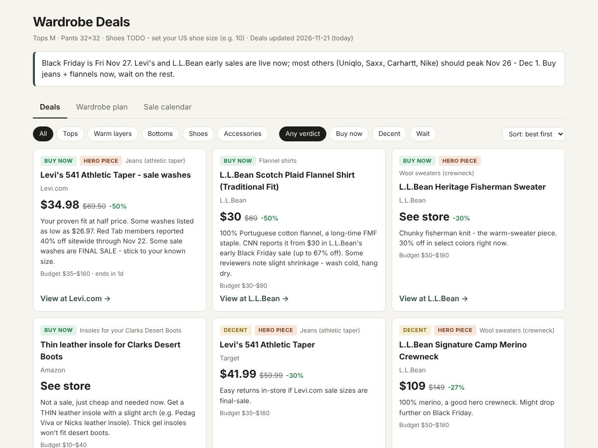

# Clothes: minimalist wardrobe deal finder

A small personal dashboard that shows deals on a minimalist, buy-it-once wardrobe in my sizes and price range. Claude Code does the web searching.



## Use it on Windows

1. Get the files once:
   ```
   git clone https://github.com/dlb3sb-afk/clothes.git
   ```
   Or on GitHub, use **Code → Download ZIP** and unzip it.
2. Double-click **`index.html`**. It opens in your browser. You don't need to install anything, and it works offline.

## Refresh deals

Open the folder in Claude Code, either the desktop app or the `claude` command in a terminal, and type:

```
/find-deals            # everything still on the shopping list
/find-deals jeans      # just one item
```

You can also just ask, for example "any good deals on wool sweaters?". Claude searches the web, filters for quality and your size and budget, and rewrites `data/deals.js`. Reload `index.html` to see the results.

If you ran it from Claude Code on the web, run `git pull` in the folder afterwards to get the new results.

## Customize

Everything lives in **`data/wardrobe.js`**:

- sizes, style notes, and brands or materials to avoid
- each item's target count, how many you `have`, budget range, quality rules and recommended picks

You can edit it by hand, or tell Claude something like "I bought 2 black tees" or "raise my sweater budget to $200".

## Files

| File | What it is |
|---|---|
| `index.html` | The dashboard (Deals / Wardrobe plan / Sale calendar) |
| `data/wardrobe.js` | Your profile and wardrobe plan |
| `data/deals.js` | Latest search results, written by Claude |
| `.claude/skills/find-deals/` | The `/find-deals` instructions Claude follows |
| `docs/gym-people-sweatpants.jpg` | Reference: the sweatpants that set the benchmark |
